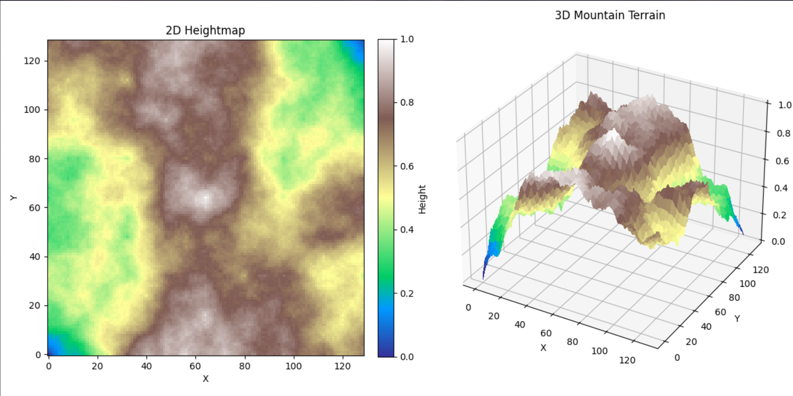
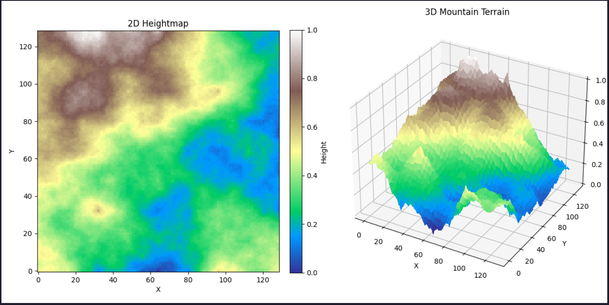
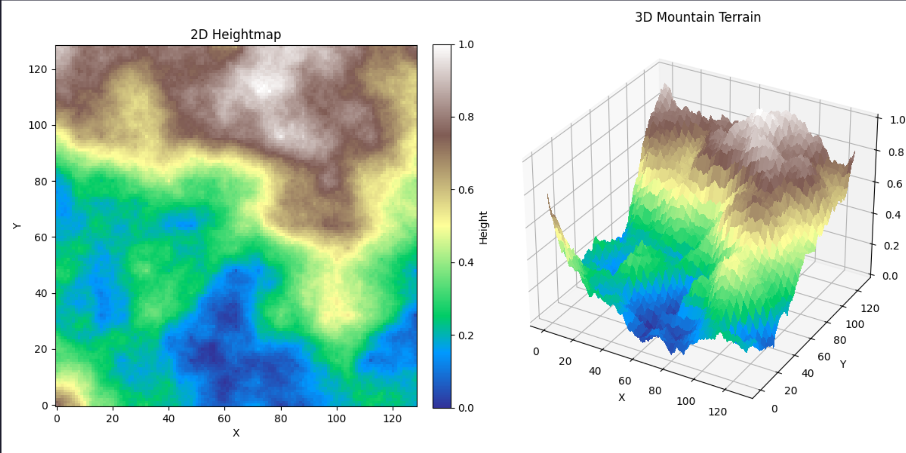
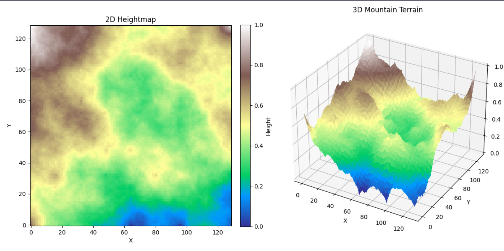

<p align="center">
  
</p>

---

# Diamond-Square Terrain Generator

A small Python project that generates random terrain using the Diamond-Square algorithm.

It creates:

- 2D terrain maps
- 3D mountain-like surfaces
- Random landscapes every time you run it

---


---

# Example Images

## Example 1


---

## Example 2


---

## Example 3


---

## Example 4


---

## What This Does

This project generates terrain procedurally.

Instead of drawing mountains manually, the program slowly creates them by:

- averaging nearby points
- adding randomness
- smoothing things out over time

Basically:

big random shapes first → smaller details later

That’s why the terrain starts looking natural instead of completely random.

---

<details>
<summary><b>How The Algorithm Works</b></summary>

<br>

## 1. Create Empty Grid

First, an empty NumPy grid is created.

```python
grid = np.zeros((size, size))
```

This grid stores terrain height values.

---

## 2. Randomize The Corners

The 4 corners get random values first.

```python
grid[0, 0] = random.random()
grid[0, step] = random.random()
grid[step, 0] = random.random()
grid[step, step] = random.random()
```

These corner values become the starting points for the entire terrain.

---

## 3. Diamond Step

The center value is calculated using the average of the corner values.

Then randomness is added so it doesn't look too smooth.

```python
avg = np.mean(corners)
grid[x + half, y + half] = avg + (np.random.rand() - 0.5) * roughness
```

This creates the larger mountain shapes.

---

## 4. Square Step

Now the edges are filled in using nearby neighbors.

```python
grid[x, y] = np.mean(neighbors) + (np.random.rand() - 0.5) * roughness
```

This starts connecting everything together.

---

## 5. Lower The Randomness

After every loop:

```python
roughness *= 0.5
```

The randomness gets reduced.

Large terrain features are generated first, then smaller details later.

That’s what gives it the natural terrain look.

---

## 6. Normalize Everything

At the end, values are scaled between `0` and `1`.

```python
grid -= grid.min()
grid /= grid.max()
```

This makes visualization easier and keeps heights consistent.

</details>

---

<details>
<summary><b>Visualization</b></summary>

<br>

The project creates 2 different views.

## 2D Heightmap

```python
imshow(heightmap, cmap='terrain')
```

Shows the terrain from above using terrain colors.

---

## 3D Terrain

```python
plot_surface(x, y, heightmap)
```

Turns the heightmap into a 3D surface.

This is the cool-looking mountain render part.

</details>

---

<details>
<summary><b>Requirements</b></summary>

<br>

Install required libraries:

```bash
pip install numpy matplotlib
```

Required:

- numpy
- matplotlib

</details>

---

<details>
<summary><b>Running The Project</b></summary>

<br>

Run the script normally:

```bash
python main.py
```

A window will open showing both the 2D and 3D terrain views.

</details>

---

<details>
<summary><b>Changing Terrain Generation</b></summary>

<br>

## Change Grid Size

```python
diamond_square(129)
```

Higher sizes = more detail.

The size must stay odd.

---

## Change Roughness

```python
roughness=0.8
```

Higher roughness:

- sharper terrain
- crazier mountains
- more noise

Lower roughness:

- smoother terrain
- softer hills

</details>

---

